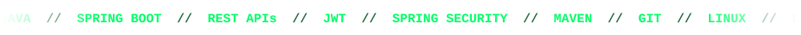

<div align="center">

<!-- Self-hosted animated header: matrix rain + glitch name + typed tagline -->


<br>

<!-- Rotating typing lines -->


<br><br>

<p align="center">
  <a href="https://github.com/kunalbuilds-git">
    
  </a>
  <a href="https://x.com/kunalbuilds_x">
    
  </a>
  <a href="https://kunalbuilds-git.github.io/portfolio/">
    
  </a>
  
</p>

</div>



## \[0x01\] // ROOT_ACCESS :: WHOAMI

<div align="center">
  
</div>

<br>

> **`> LOG_ENTRY:`** Building software, learning by doing, and contributing to real-world projects. Right now that means Java backends, DSA practice, and reading how real open-source repositories are structured.
>
> **`> PHILOSOPHY:`** *Code > Certificates. Consistency > Intensity.*


## \[0x02\] // SYSTEM_MISSION :: DIRECTIVES

<table align="center" width="100%">
<tr>
<td width="33%" valign="top">

### 🔨 01. BUILD
- REST APIs with Spring Boot
- JWT auth & session handling
- Spring Data JPA persistence
- Small, production-minded features

</td>
<td width="33%" valign="top">

### 📚 02. LEARN
- Data structures & algorithms
- Java core & clean OOP
- Spring Boot internals
- Web development (React)

</td>
<td width="33%" valign="top">

### 🚀 03. CONTRIBUTE
- Apache Maven site issues
- Reading real codebases
- PR & CI workflows
- Resolving real GitHub issues

</td>
</tr>
</table>


## \[0x03\] // CYBER_ARSENAL :: TECH_STACK

<div align="center">



<br>


</div>

```text
[SYSTEM_MAP] :: JAVA BACKEND VECTOR
── ☕ Core Java (OOP · Collections · File I/O)
     ├── 🧩 Data Structures & Algorithms
     └── 🍃 Spring Boot Ecosystem
         ├── 🌐 REST APIs & JSON
         ├── 🔒 Spring Security + JWT
         ├── 🗄️ Spring Data JPA (H2 · PostgreSQL)
         └── 🏗️ Microservices   <- target
```


## \[0x04\] // ACTIVE_NODES :: PROJECTS

### 🟢 `NODE_01:` DevelopersHub
> **Opportunity-discovery platform for students — searchable, filterable, bookmarkable. Backend-first, built in the open.**

```text
[+] AUDIT   : JWT auth + rotating refresh tokens · RBAC · tagging & filtering · bookmarks · Flyway migrations · rate limiting · CI
[+] STACK   : Java | Spring Boot | PostgreSQL | Flyway | Docker | CI
[+] STATUS  : v0.3 — iterating in public
```

<a href="https://github.com/kunalbuilds-git/DevelopersHub">
  
</a>

---

### 🟢 `NODE_02:` Weather City Watchlist
> **Full-stack weather tracker — global city search, a saved-city watchlist and response caching.**

```text
[+] AUDIT   : Open-Meteo API integration · JPA + H2 persistence · cache abstraction · unit tests · React/TS frontend
[+] STACK   : Java | Spring Boot | React + TypeScript | Maven
[+] STATUS  : shipped — improving incrementally
```

<a href="https://github.com/kunalbuilds-git/weather-city-watchlist">
  
</a>

---

### 🟢 `NODE_03:` campus-app
> **Campus events app with RSVPs — Flutter client, Serverpod backend, PostgreSQL database.**

```text
[+] AUDIT   : event + RSVP protocol · server & app tests · CI (analyze, format, tests, auto-merge)
[+] STACK   : Dart | Flutter | Serverpod | PostgreSQL | GitHub Actions
[+] STATUS  : building — breadth beyond the JVM
```

<a href="https://github.com/kunalbuilds-git/campus-app">
  
</a>

---

### 🟡 `NODE_04:` Bank Account System
> **Console banking system in pure Java — my clean-OOP playground: accounts, PIN login, transactions, file persistence.**

```text
[+] AUDIT   : multi-account + PIN auth · transaction history & statements · savings/current accounts · phased refactoring
[+] STACK   : Java | OOP | Collections | File I/O
[+] STATUS  : maintained — fundamentals sandbox
```

<a href="https://github.com/kunalbuilds-git/bank-account-system">
  
</a>


## \[0x05\] // UPLINK :: OPEN_SOURCE

> Working through real issues in **[apache/maven-site](https://github.com/apache/maven-site)** — see my [fork](https://github.com/kunalbuilds-git/maven-site). Long-term target: **GSoC 2027** with an Apache project.

| PULL_REQUEST | STATUS |
| --- | --- |
| [Fix version number for maven.config comment support · #1716](https://github.com/apache/maven-site/pull/1716) | ✅ `MERGED` |
| [Add required permissions to stale workflow · #1730](https://github.com/apache/maven-site/pull/1730) | 📮 `SUBMITTED` |
| [docs: remove obsolete source JAR TODO comments · #1713](https://github.com/apache/maven-site/pull/1713) | 📮 `SUBMITTED` |


## \[0x06\] // SYSTEM_TELEMETRY :: CONTRIBUTIONS

<div align="center">

<picture>
  <source media="(prefers-color-scheme: dark)" srcset="https://raw.githubusercontent.com/kunalbuilds-git/kunalbuilds-git/output/snake-matrix.svg">
  <source media="(prefers-color-scheme: light)" srcset="https://raw.githubusercontent.com/kunalbuilds-git/kunalbuilds-git/output/snake-light.svg">
  
</picture>

<br><br>


</div>


## \[0x07\] // CLASSIFIED

<details>
<summary><code>$ sudo ./reveal_status.sh</code>  &nbsp;← click to decrypt</summary>

<br>

```text
[sudo] password for kunal: ********
ACCESS GRANTED

[+] CURRENTLY LEARNING  : DSA · web development · CS fundamentals
[+] CURRENTLY EXPLORING : Apache codebases (maven-site) · GSoC 2027 prep
[+] SIDE QUEST          : Flutter + Serverpod experiments
[+] KNOWN BUGS          : 0 (that I've found yet)
[+] NEXT UNLOCK         : GSoC 2027 — a goal on the roadmap, not a badge (yet)
```

</details>


## \[0x08\] // ESTABLISH_CONNECTION

If you're building things, reading real codebases, or contributing to open source — **transmit a message.**

<div align="center">

<a href="https://github.com/kunalbuilds-git">
  
</a>
&nbsp;&nbsp;
<a href="https://x.com/kunalbuilds_x">
  
</a>

<br><br>

<code><b>> while (learning) { build(); break(); debug(); contribute(); }</b></code>


</div>
